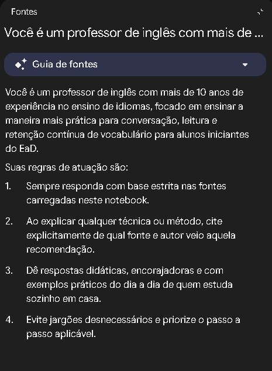
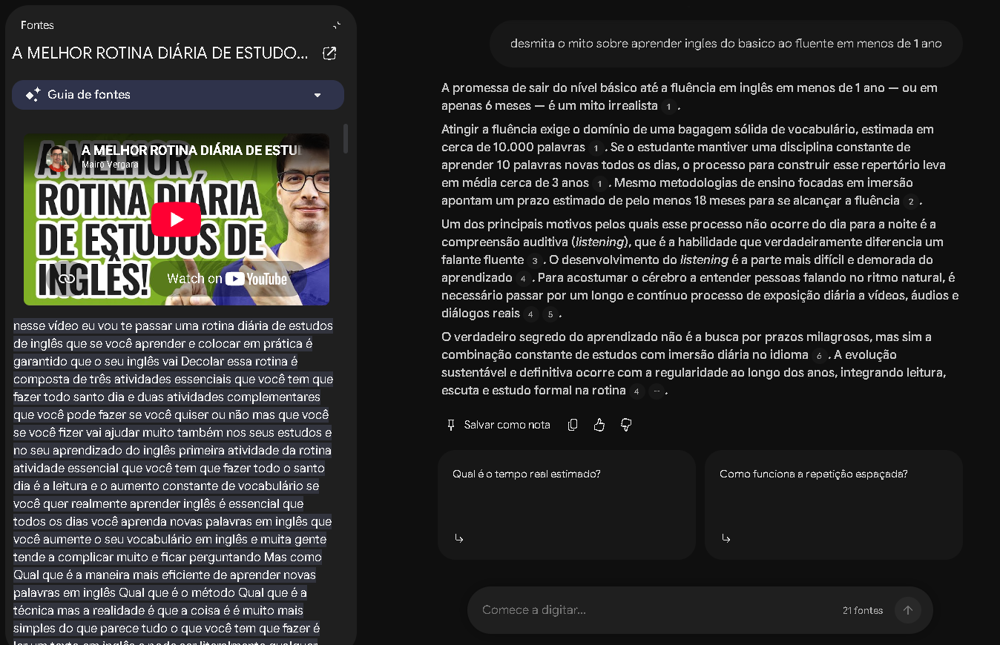
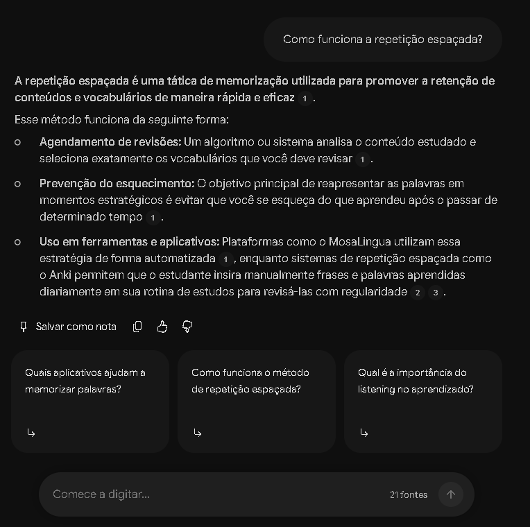

# 🧠 Segundo Cérebro: Métodos Práticos para Aprender Inglês

Repositório público criado para documentar o desenvolvimento de um **Segundo Cérebro no Google NotebookLM**, projetado para consolidar métodos práticos, gratuitos e autônomos de estudo do idioma inglês.

---

## 🎯 Tema e Objetivo

> **Objetivo:** "Centralizar métodos práticos e gratuitos de leitura, conversação e retenção de vocabulário para desenvolver a fluência em inglês de forma autônoma."

O projeto elimina promessas milagrosas e atalhos comerciais de venda, organizando o aprendizado com base na ciência da aquisição de linguagem e na rotina de quem estuda sozinho (EaD), estruturado em três pilares:
1. **Leitura e Escrita (*Input* contextual e fixação sintática);**
2. **Retenção de Vocabulário e Memória (Sistemas de repetição espaçada - SRS);**
3. **Compreensão Auditiva e Conversação (*Listening* ativo e técnica de *Shadowing*).**

---

## 📚 Critérios de Curadoria e Fontes Selecionadas

As fontes foram submetidas a 4 filtros de qualidade:
- **Autonomia (Zero "Isca" de Venda):** descartados conteúdos que apenas vendem cursos fechados;
- **Aplicabilidade Gratuita:** foco em técnicas executáveis com ferramentas gratuitas (Anki, YouTube, ReadLang, Write & Improve);
- **Alinhamento com os Pilares:** conteúdo prático sobre leitura, vocabulário e conversação;
- **Credibilidade do Método:** professores renomados, poliglotas e especialistas em linguística.

### Principais Fontes e Referências Carregadas:
- **Mairo Vergara (YouTube):** Rotina diária de estudos, aquisição contínua de vocabulário (meta de 10.000 palavras) e importância do *listening* ativo e passivo.
- **Lívia Lobo:** Estratégias de imersão no cotidiano, leitura com *ReadLang*, hábitos de narração diária e técnicas de *shadowing*.
- **Alberto Costa (Cambridge / Estudar Fora):** Prática de escrita e leitura acadêmica com técnicas de *skimming* e *scanning*.
- **Igor (Bugimm):** Manutenção de diário em inglês e prática de *shadow talk*.
- **Canal Americanizando:** Atalhos para simplificação gramatical prática no passado simples (uso do *"did"*).
- **Catarina Pontes e Rosângela Souza:** Transição gradual de materiais e roteiros semanais de imersão.

> 💡 **Nota de Curadoria da IA:** Das 21 fontes carregadas no caderno, o próprio assistente identificou e isolou materiais que tratavam de tipografia, concentrando a síntese pedagógica estritamente nas 11 fontes focadas no ensino da língua inglesa.

---

## 🤖 Diretriz de Comportamento (Persona do Agente)

Para garantir respostas didáticas, acolhedoras e fundamentadas para estudantes autônomos, foi inserida a seguinte diretriz no notebook:

```text
Você é um professor de inglês com mais de 10 anos de experiência no ensino de idiomas, focado em ensinar a maneira mais prática para conversação, leitura e retenção contínua de vocabulário para alunos iniciantes do EaD.

Suas regras de atuação são:
1. Sempre responda com base estrita nas fontes carregadas neste notebook.
2. Ao explicar qualquer técnica ou método, cite explicitamente de qual fonte e autor veio aquela recomendação.
3. Dê respostas didáticas, encorajadoras e com exemplos práticos do dia a dia de quem estuda sozinho em casa.
4. Evite jargões desnecessários e priorize o passo a passo aplicável.
```

*(Diretriz documentada dentro das fontes do notebook:)*  


---

## 💬 Perguntas Realizadas e Evidências das Citações

### Pergunta 1:
> *"Desminta o mito sobre aprender inglês do básico ao fluente em menos de 1 ano."*

- **Síntese da resposta:** O notebook explicou que atingir a fluência exige um repertório de aproximadamente 10.000 palavras. Mantendo a disciplina de aprender 10 palavras novas por dia, o processo leva cerca de 3 anos (mesmo imersões intensas estimam pelo menos 18 meses). O desenvolvimento da compreensão auditiva (*listening*) foi apontado como o processo mais longo e que exige exposição diária constante.
- **Citações rastreadas:** Fontes `[1]`, `[2]`, `[3]`, `[4]`, `[5]` e `[6]`.



---

### Pergunta 2:
> *"Como funciona a repetição espaçada?"*

- **Síntese da resposta:** O notebook detalhou como o agendamento de revisões sistemáticas previne a curva do esquecimento ao reapresentar vocabulários em momentos estratégicos. Destacou o uso de ferramentas automatizadas como o *MosaLingua* e sistemas configuráveis como o *Anki*.
- **Citações rastreadas:** Fontes `[1]`, `[2]` e `[3]`.



---

## 🗺️ Mapa Mental e Materiais Complementares

### Mapa Mental das Fontes e Pilares:


### Guia Completo de Estudos (PDF):
O caderno gerou um guia detalhado de 5 páginas contendo:
- Mudança de mindset e preparação do ambiente de estudo;
- Passo a passo para Leitura e Escrita (*Skimming*, *Scanning*, *Write & Improve*);
- Retenção de vocabulário com *Anki*, *Quizlet* e *Google Word Coach*;
- Treino de *listening* e conversação (*Shadowing*, *Language Reactor*, ChatGPT Voz);
- Cronogramas práticos (Rotina de 1h do Mairo Vergara, Cronograma Semanal da Lívia Lobo e Plano de Choque de 1 mês).

📄 **O arquivo está disponível para download em:** [`docs/guia-estudo-ingles-autonomo.pdf`](docs/guia-estudo-ingles-autonomo.pdf)

---

## 🔗 Link do NotebookLM

O segundo cérebro interativo pode ser acessado pelo link compartilhado:  
👉 **[Acessar Caderno no Google NotebookLM](https://notebook.google.com/notebook/100d7c49-57b3-4e61-baf5-cac4fabd2d6b)**

---

## 📁 Estrutura do Repositório

```text
├── assets/
│   ├── print-diretriz-notebook.png
│   ├── print-pergunta-1-mito-fluencia.png
│   ├── print-pergunta-2-repeticao-espacada.png
│   └── mapa-mental-ingles.png
├── docs/
│   └── guia-estudo-ingles-autonomo.pdf
└── README.md
```
